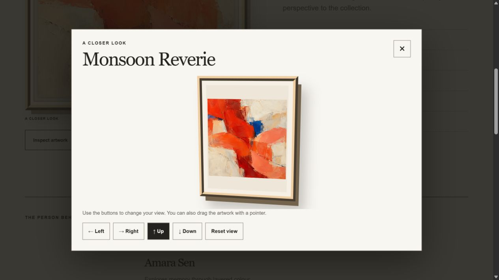
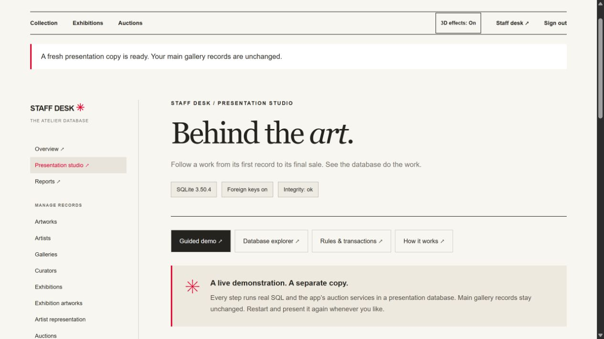

# Atelier — Art Gallery, Exhibition & Auction Management System

A local final-year DBMS demonstration with a museum-style public website, a staff data desk, genuine SQLite constraints, simulated auctions, and explainable SQL reports. The visual direction takes inspiration from The Met's editorial typography and artwork-led presentation; Atelier's identity, fictional collection, and generated assets are original.





## Run on Windows

Python 3.11 or newer is required. Double-click **start.cmd**, or run:

```powershell
.\start.ps1
```

The launcher creates `.venv` and installs dependencies on the first run, then serves the app at **http://127.0.0.1:5000**. The first launch initializes `instance/atelier.sqlite`. Subsequent launches retain your changes. Stop the server with Ctrl+C in its terminal.

Manual setup:

```powershell
python -m venv .venv
.\.venv\Scripts\python.exe -m pip install -r requirements.txt
.\.venv\Scripts\python.exe run.py
```

No Node build, external database server, email connection, or payment service is required. After dependencies are installed, the application and its visual assets work offline. It binds only to the local computer.

## Demo accounts

| Role | Email | Password | Initial activity |
|---|---|---|---|
| Staff | admin@atelier.example | AdminDemo!2026 | All management pages, auction controls, payment recording, SQL reports |
| Bidder | maya@atelier.example | BidderDemo!2026 | Active bids and a completed ₹55,000 purchase |
| Bidder | arjun@atelier.example | BidderDemo!2026 | Competing bids and a ₹45,000 purchase pending payment |
| Bidder | sara@atelier.example | BidderDemo!2026 | New account with no bids or purchases |

On the login page, choose a demo account to fill its credentials, then select **Sign in**. These use normal password verification, hashed credentials, and server-enforced roles. The displayed credentials are intentionally public local-demo fixtures. There is no public registration or password recovery.

## What is included

- Public home, searchable/filterable collection, artwork histories, exhibitions and auctions.
- Original semi-3D hero composed of rendered sculpture cutouts, framed artworks, CSS pedestals and soft shadows. Gentle pointer parallax respects reduced-motion preferences; touch layouts are static.
- Staff forms for all editable domain records, associative relationships, and expert assessments.
- Bids and sales are historical ledgers: they are created through auction operations, not arbitrary CRUD forms. Accepted bids and final sale details cannot be edited or deleted; staff can update payment status.
- Staff-controlled auction opening and lot closure; bidder accounts and purchase histories.
- Six SQL report presets showing query text and live results. The application never executes arbitrary SQL supplied by a visitor.

## Seed and reset

The seed contains 6 artists, 12 artworks, 2 galleries, 3 curators, 3 exhibitions, 2 experts, 3 bidders, 3 auctions, 7 lots, 10 bids, 2 collectors, 2 sales, and linked assessment/representation/display records. All profiles and commercial activity are fictional.

- **Autumn Contemporary** (auction 1) is open, with lots 101 and 102.
- **Winter Preview** (auction 2) is draft, with lots 201 and 202.
- **Recent Acquisitions** (auction 3) is closed: lots 301 and 302 sold; lot 303 missed its reserve. Its event and sale dates use the seed snapshot date.
- Seed event dates describe fictional exhibition/auction schedules. Bidding is controlled explicitly by staff rather than by a clock, so the walkthrough remains available after those dates.

Idempotently check/add the seed:

```powershell
.\.venv\Scripts\python.exe -m flask --app run seed
```

Restore the original fixture, replacing all your local demonstration changes:

```powershell
# Stop the running server first. This prompts before replacing data.
.\.venv\Scripts\python.exe -m flask --app run reset-demo
# For an intentional unattended reset:
.\.venv\Scripts\python.exe -m flask --app run reset-demo --yes
```

Normal startup does not reset or reseed an existing database. Keep a copy of the SQLite file if you want to preserve a presentation dataset before resetting it.

## Presentation walkthrough

### Present smoothly from the admin portal

Sign in as **Admin**, open **Staff desk → Presentation studio**, and choose **Start guided demo**. Run the eight steps in order: artwork creation, exhibition membership, expert records, auction opening, Maya's bid, Sara's higher bid, sale, and completed payment. Each step shows before/after rows, actual executed SQL and a parameterized result query. Revisit any completed result without rerunning it. **Restart demo** begins a fresh presentation copy.

The guided flow runs real SQL and the same auction services in a separate session-specific SQLite database. The main gallery database is unchanged. A completed step and its evidence are published together from a staged SQLite snapshot; duplicate submissions are rejected, and failures preserve the previous step. This runner is for the local single-process presentation server.

Use the studio's other views to explain the backend:

- **Database explorer:** live table DDL, column types, primary keys, required fields, foreign keys, indexes, row counts and previews for all 16 domain tables. Login records and password hashes are excluded.
- **Rules & transactions:** actual SQLite triggers and Python transaction services.
- **How it works:** the browser → Flask → SQLite → rendered-result request flow, with presentation shortcuts.
- **Reports:** the main gallery's six live aggregate/join queries remain available in the staff navigation.

### Explore the frames

Artwork cards have deeper beveled frames, mat boards and edge shadows. Hovering a hero frame tilts it; selecting it opens the artwork. Use **Inspect artwork** on a card or detail page to open the larger viewer. Rotate with Left/Right/Up/Down buttons or drag; **Reset view** restores the angle. Escape closes the dialog and returns focus to its opening button. The **3D effects** toggle remembers your preference; automatic movement pauses for touch and reduced-motion users. All inspection functions have keyboard-accessible buttons.

### Present using the ordinary account and management pages

1. Browse the home, collection, exhibitions, and an artwork's expert history.
2. Sign in as staff. In **Staff desk → Artworks**, create an artwork using an existing artist and one of the original collection images. Its initial status is `available`.
3. In **Exhibition artworks**, link the new artwork to an exhibition with a display position.
4. Add an **Appraisal** and **Artwork authentication** record, selecting an existing art expert. Use a unique certificate number.
5. In **Auction lots**, add the artwork to **Winter Preview**, with an unused lot number (such as 3), a ₹50,000 starting price, and a ₹60,000 reserve.
6. Open **Auctions → Winter Preview** and select **Open auction**. Opening affects every draft lot in that auction atomically.
7. Sign out and use Maya to bid ₹65,000. Sign out and use Sara to bid ₹70,000. A second browser session can demonstrate competing bidders without repeatedly signing out.
8. Sign in as staff, open the auction, and **Close lot**. Sara becomes its collector and a pending ₹70,000 sale is recorded.
9. In **Staff desk → Sales**, set that sale's payment status to completed.
10. Open **Reports → Collector spending** and **Revenue by gallery**. Show both the SQL and the changed totals.
11. Show constraint behavior: repeat a bid amount, delete a referenced artist, duplicate an exhibition-artwork pair, or enter reversed exhibition dates. The application preserves data and explains the rejection.

You can also close Autumn Contemporary's lot 102 immediately to show an unsold outcome: its seeded highest bid is ₹35,000 and its reserve is ₹40,000.

## Database mapping and normalization

`atelier/schema.sql` is the authoritative DDL; `atelier/seed.py` creates the fixture; `atelier/services.py` implements transactional auction operations. The 16 supplied domain entities are retained, plus `user_account` for website authentication.

| Table | Key and relationship mapping |
|---|---|
| artist | `artist_id`; artist profile and life dates |
| artwork | `artwork_id`; mandatory `artist_id` → artist |
| gallery | `gallery_id`; gallery profile and contact details |
| curator | `curator_id`; curator profile |
| exhibition | `exhibition_id`; mandatory `gallery_id` and `curator_id` |
| artist_gallery | composite `(artist_id, gallery_id)`; dates and commission |
| exhibition_artwork | composite `(exhibition_id, artwork_id)`; display position |
| auction | `auction_id`; mandatory organizing `gallery_id`; workflow status |
| auction_lot | `lot_id`; mandatory `auction_id` and `artwork_id`; unique auction/lot number and auction/artwork pairs |
| bid | `bid_id`; mandatory lot and bidder; immutable accepted bid history |
| bidder | `bidder_id`; unique email; bidder contact details |
| sale | `sale_id`; unique mandatory winning `bid_id`; mandatory collector; final price, date and payment status |
| collector | `collector_id`; unique mandatory `bidder_id` identifies the same buyer |
| art_expert | `expert_id`; expert profile and specialization |
| appraisal | `appraisal_id`; mandatory artwork and expert; estimate and date |
| authentication | `authentication_id`; mandatory artwork and expert; unique certificate, result and date |
| user_account | `user_id`; password hash, role, and optional unique bidder link; role/link consistency check |

The foreign keys added to relational tables implement the Chen relationships. Mandatory child participation becomes a non-null foreign key; partial parent participation permits a parent with no child records. Many-to-many relationships use the two associative tables, whose non-null composite primary keys prevent duplicate memberships. A winning bid may have zero or one sale through `sale.bid_id UNIQUE NOT NULL`.

The design separates artists, curators, galleries and experts instead of repeating their names on every dependent row. Junction attributes depend on the complete composite key. Scalar profile fields remain atomic at the application's scope. Collector contact fields are retained because the supplied model explicitly includes them; its unique bidder link preserves buyer identity. Normalized reports join through identities rather than matching names or emails.

`Total_Amount_Spent` is derived using a conditional aggregate over completed payments and is not stored on the collector. The final selling price exists only on `sale`, and is checked against the winning bid when the sale is created. The immutable bid amount is the historical offer; it is not a second final-price field on the lot.

### Integrity and transactions

- Every connection enables `PRAGMA foreign_keys=ON`; relationship/history deletion uses `RESTRICT`.
- `NOT NULL`, `UNIQUE`, `CHECK`, composite keys and a partial unique index enforce mandatory references, nonnegative integer-paise amounts, calendar/date ordering, commission bounds, unique certificates and one active lot per artwork.
- Database triggers reject invalid bids even through direct SQL, preserve accepted bids/finalized sale details, and validate winning bidder, collector, reserve, price, and one sale per lot.
- `BEGIN IMMEDIATE` serializes the read/check/write portions of bidding, auction opening and lot closure. Failure rolls the whole operation back; repeated closure returns the existing outcome.
- Opening requires available artworks and at least one draft lot. Closing creates/reuses the matching collector, inserts the sale only if the reserve is met, updates lot/artwork status, and closes the auction when every lot is finished.
- Parameterized values and an allow-list of table/column identifiers protect management routes. CSRF tokens protect POST actions; user roles are checked on the server. Session cookies use HttpOnly and SameSite=Lax. The local session secret is generated under `instance/.secret`.

### Reports

`atelier/queries.py` contains six SELECT presets: collection joins, exhibition lineups, lot bid aggregation, gallery revenue, collector spending, and missing assessments. LEFT JOIN preserves empty relationships; conditional SUM counts only completed payments; NOT EXISTS finds missing assessments without multiplying historical rows.

Initial completed-payment revenue is ₹55,000 for Atelier Mumbai and ₹0 for Atelier Delhi. Maya has spent ₹55,000; Arjun's pending ₹45,000 does not contribute to completed spending.

## Verification

```powershell
.\.venv\Scripts\python.exe -m pytest -q
```

Tests use isolated temporary databases, leaving the delivered fixture unchanged. Coverage includes accounts and roles, CSRF rejection, staff CRUD and preset reports, full presentation flow, seeding idempotency, restart persistence, date/money/reference constraints, immutable history, reserve failure, rollback and concurrent bidding/closure. Visual review covers public/staff pages, mobile layout and reduced motion.

Asset prompts and built-in generation provenance are recorded in `docs/asset-prompts.md`. Original final assets live in `atelier/static/images/`; the application does not fetch images from remote sites.
